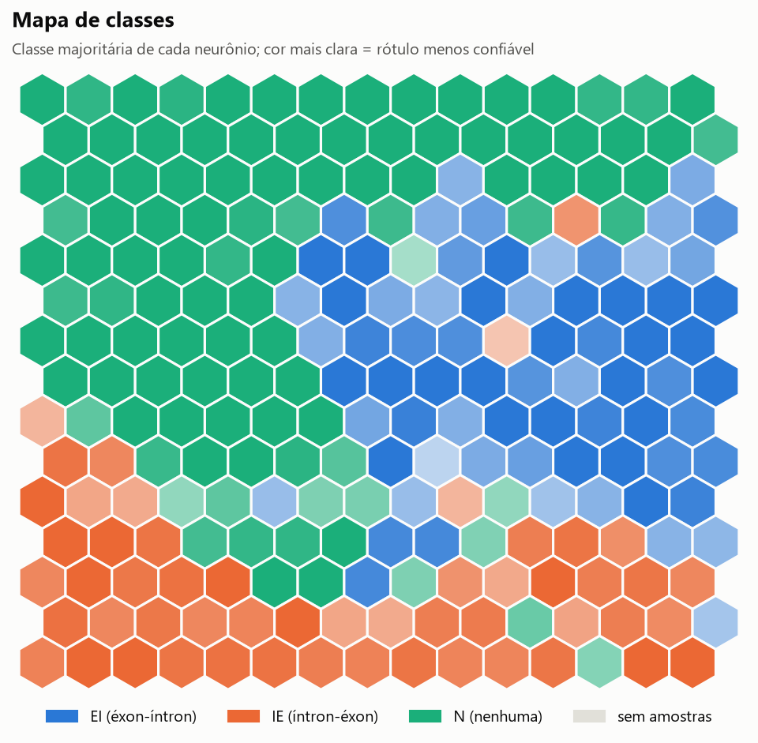
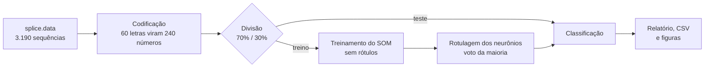
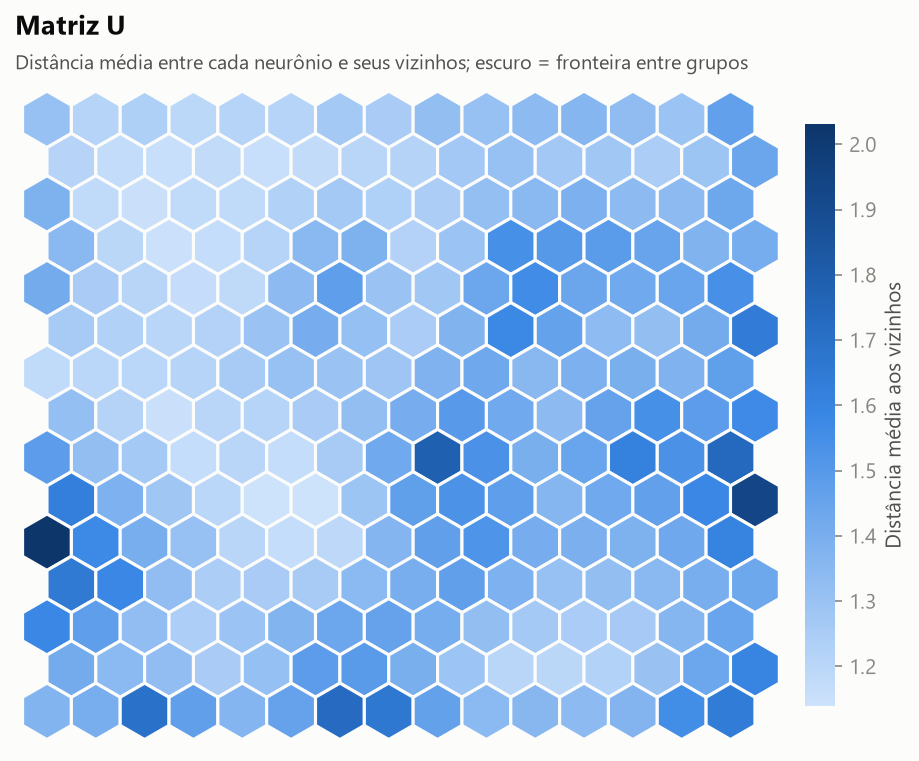
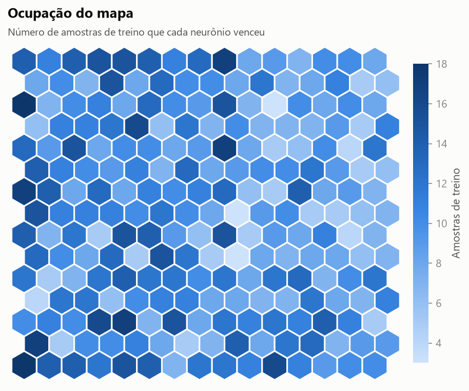
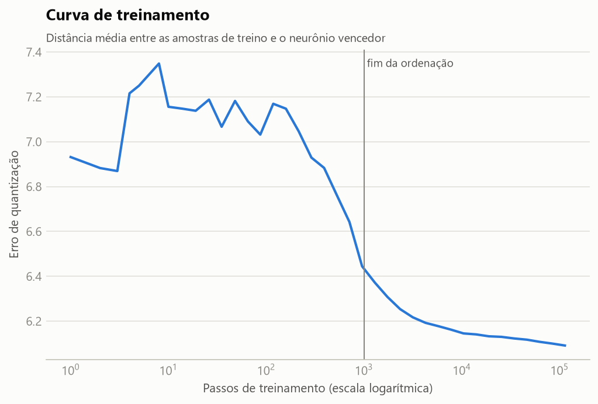

<h1 align="center">Mapa Auto-Organizável de Kohonen (SOM)</h1>

<p align="center">
  <em>Classificação de sequências de DNA com uma rede neural não supervisionada,<br>
  implementada do zero em Python com NumPy.</em>
</p>

<p align="center">
  
  
  
  
</p>

<p align="center">
  
</p>

<p align="center">
  <sub>Cada hexágono é um neurônio. O mapa foi treinado <b>sem ver os rótulos</b> e, mesmo assim,
  os três tipos de trecho de DNA foram parar em três regiões separadas.</sub>
</p>

---

## Sumário

- [O projeto em um minuto](#o-projeto-em-um-minuto)
- [Como executar](#como-executar)
- [A base de dados](#a-base-de-dados)
- [Como o SOM funciona](#como-o-som-funciona)
- [Como analisar os resultados](#como-analisar-os-resultados)
- [Experimentos para explorar](#experimentos-para-explorar)
- [Estrutura do projeto](#estrutura-do-projeto)
- [Limitações](#limitações)
- [Referências](#referências)

---

## O projeto em um minuto

Um **Mapa Auto-Organizável** (SOM, de *Self-Organizing Map*) é uma rede neural que
aprende sem professor. Ela recebe dados sem rótulo e os distribui sobre uma grade
de neurônios, de modo que **dados parecidos fiquem em neurônios vizinhos**. O
resultado é um mapa em duas dimensões de dados que têm centenas de dimensões.

Neste projeto:

| | |
|---|---|
| **Dados** | 3.190 trechos de DNA de 60 letras, de três tipos (`EI`, `IE` e `N`) |
| **Rede** | mapa hexagonal de 15 × 15 = 225 neurônios, treinado sem os rótulos |
| **Uso** | depois de treinado, cada neurônio recebe o nome da classe mais comum entre as sequências que caíram nele, e o mapa passa a funcionar como classificador |
| **Resultado** | **84,52%** de acerto em 956 sequências que o mapa nunca tinha visto |

O algoritmo segue o artigo clássico de Kohonen (1990). A forma de rotular o mapa e
de medir o resultado vem de Mohamed et al. (2013), que aplicam o SOM a sequências
de DNA.

---

## Como executar

**Requisitos:** Python 3 instalado e, apenas na primeira execução, acesso à
internet para baixar NumPy e Matplotlib.

### Opção 1 — duplo clique (Windows)

Dê um duplo clique em [`executar.bat`](executar.bat). Ele:

1. cria o ambiente virtual `.venv` e instala as dependências (só na primeira vez,
   cerca de um minuto);
2. roda o script (cerca de 15 segundos);
3. abre a pasta `resultados` com o relatório e as figuras.

### Opção 2 — pelo terminal

```bash
python -m venv .venv
```

```bash
.venv\Scripts\pip install -r requirements.txt
```

```bash
.venv\Scripts\python kohonen_som.py
```

Em Linux ou macOS, troque `.venv\Scripts\` por `.venv/bin/`.

### Opções

Todas são opcionais; sem nenhuma, o script usa os valores da coluna "Padrão".
Também funcionam com o `.bat`, por exemplo `executar.bat --semente 7`.

| Opção | Padrão | O que muda |
|---|---|---|
| `--linhas`, `--colunas` | 15, 15 | tamanho do mapa |
| `--topologia` | `hexagonal` | formato da grade: `hexagonal` (6 vizinhos) ou `retangular` (8 vizinhos) |
| `--vizinhanca` | `gaussiana` | como o aprendizado se espalha: `gaussiana` (suave) ou `bolha` (tudo ou nada) |
| `--passos-ordenacao` | 1000 | duração da primeira fase do treinamento |
| `--passos-ajuste` | 500 × neurônios | duração da segunda fase do treinamento |
| `--teste` | 0.3 | fração das sequências reservada para o teste |
| `--semente` | 42 | semente dos sorteios; a mesma semente reproduz o mesmo resultado |
| `--dados` | `data/splice.data` | arquivo da base |
| `--saida` | `resultados` | pasta onde os arquivos são gravados |

```bash
.venv\Scripts\python kohonen_som.py --linhas 20 --colunas 20 --topologia retangular
```

> [!NOTE]
> Cada execução **sobrescreve** os arquivos da pasta de saída. Para guardar
> resultados de configurações diferentes, use `--saida outra_pasta`.
>
> O tempo de treinamento cresce rápido com o tamanho do mapa: 15 × 15 leva cerca
> de 15 segundos, mas 25 × 25 leva cerca de 6 minutos.

---

## A base de dados

**Molecular Biology (Splice-junction Gene Sequences)**, do UCI Machine Learning
Repository — <https://archive.ics.uci.edu/dataset/69>
(DOI [10.24432/C5M888](https://doi.org/10.24432/C5M888), licença CC BY 4.0).
Os arquivos já estão em [`data/`](data/); nada é baixado durante a execução.

### O problema biológico

Um gene alterna dois tipos de trecho: **éxons**, que são usados para fabricar a
proteína, e **íntrons**, que a célula recorta e descarta. Os pontos de corte são
as fronteiras entre eles:

```text
          éxon                 íntron                 éxon
  ...████████████████|----------------------|████████████████...
                     ^                      ^
               fronteira EI           fronteira IE
             (éxon -> íntron)       (íntron -> éxon)
```

Cada linha da base é uma janela de **60 letras** de DNA (A, C, G, T) de primatas,
com um rótulo que diz o que existe exatamente no meio da janela:

| Classe | O que há no meio da janela | Quantidade |
|---|---|---|
| `EI` | fronteira onde termina um éxon e começa um íntron | 767 (24%) |
| `IE` | fronteira onde termina um íntron e começa um éxon | 768 (24%) |
| `N` | nenhuma fronteira | 1.655 (52%) |

Um exemplo de cada classe, com o meio da janela marcado por `|`:

```text
classe   30 letras antes do meio          30 letras depois do meio
EI       CCAGCTGCATCACAGGAGGCCAGCGAGCAG | GTCTGTTCCAAGGGCCTTCGAGCCAGTCTG
IE       TTCAGCGGCCTCAGCCTGCCTGTCTCCCAG | GTCTCTGTCCTTCCACCATGGCCCTGTGGA
N        CAAAAGAACAAAGCTGGAGGCATCACGCTA | CCTGACTTCAAACTATACTACAAGGCTACA
```

### Por que dá para aprender isso

As fronteiras deixam "assinaturas" nas letras ao redor do meio. Contando na
própria base:

| Padrão | `EI` | `IE` | `N` |
|---|---|---|---|
| `GT` logo **depois** do meio | **99,0%** | 14,1% | 5,9% |
| `AG` logo **antes** do meio | 50,7% | **99,5%** | 7,7% |

O SOM não recebe essa regra pronta: ele compara as sequências inteiras, posição
por posição, e precisa descobrir sozinho que essas poucas letras fazem diferença.
Como as outras posições variam muito, a separação nunca fica perfeita — e é isso
que as métricas do relatório medem.

---

## Como o SOM funciona



### 1. Codificação

O SOM clássico só entende vetores de números. Cada letra vira 4 números, um para
cada base possível:

```text
A = 1 0 0 0      C = 0 1 0 0      G = 0 0 1 0      T = 0 0 0 1
```

Uma sequência de 60 letras vira, portanto, um vetor de 240 números. A base tem
alguns raros códigos ambíguos (por exemplo `N` = "qualquer base"), que repartem o
peso entre as bases possíveis (`N` = 0,25 0,25 0,25 0,25).

### 2. Divisão em treino e teste

70% das sequências (2.234) treinam e rotulam o mapa. Os outros 30% (956) ficam
guardados e só são usados no final, para medir o acerto em dados novos. A divisão
é estratificada: mantém a proporção das três classes nos dois conjuntos.

### 3. Treinamento

Cada neurônio guarda um vetor de 240 números (seu "peso"), que funciona como uma
sequência típica. O treinamento repete três passos milhares de vezes:

1. **Sorteia** uma sequência $x$ do conjunto de treino.
2. **Acha o vencedor**: o neurônio $c$ cujo peso está mais perto de $x$.

$$c = \arg\min_i \lVert x - m_i \rVert$$

3. **Atualiza** o vencedor e os seus vizinhos na grade, puxando os pesos na
   direção de $x$. Quanto mais longe do vencedor, menor o puxão.

$$m_i(t+1) = m_i(t) + h_{ci}(t)\,[\,x(t) - m_i(t)\,]$$

$$h_{ci}(t) = \alpha(t)\,\exp\left(-\frac{\lVert r_i - r_c \rVert^2}{\sigma(t)^2}\right)$$

Aqui $m_i$ é o peso do neurônio $i$, $r_i$ é a posição dele na grade, $\alpha$ é a
taxa de aprendizado e $\sigma$ é o raio da vizinhança. É por atualizar também os
vizinhos que o mapa fica organizado: neurônios próximos aprendem coisas parecidas.

Seguindo as recomendações práticas de Kohonen, o treinamento tem duas fases:

| Fase | Passos | Taxa de aprendizado α | Raio da vizinhança σ | Para que serve |
|---|---|---|---|---|
| **Ordenação** | 1.000 | cai de 0,9 para 0,05 | encolhe de 7,5 para 1 | organizar o mapa como um todo |
| **Ajuste fino** | 112.500 (500 por neurônio) | cai de 0,05 para 0,001 | fixo em 1 | refinar cada neurônio sem desfazer a ordem |

Os pesos iniciais são 225 sequências de treino sorteadas.

### 4. Rotulagem do mapa

Terminado o treinamento, as sequências de treino são apresentadas de novo e cada
neurônio **conta quantas de cada classe ele venceu**. O maior contador define o
rótulo do neurônio. A **confiabilidade** do rótulo é a fração das sequências do
neurônio que pertencem a essa classe: um neurônio que venceu 9 `EI` e 1 `N` é
`EI` com confiabilidade 0,9.

### 5. Classificação

Uma sequência nova recebe o rótulo do seu neurônio vencedor. Se o vencedor não
tiver rótulo (não venceu nenhuma sequência de treino), vale o neurônio rotulado
mais próximo.

### Onde cada parte está no código

| Parte | Em [`kohonen_som.py`](kohonen_som.py) | Origem |
|---|---|---|
| Leitura e codificação | `carregar_splice`, `codificar` | — |
| Grade hexagonal e vizinhança | `SOM.__init__`, `SOM._nucleo` | Kohonen (1990), Fig. 2 e Eq. (8) |
| Treinamento em duas fases | `SOM.treinar` | Kohonen (1990), Eq. (2'), (7) e Seção II-D |
| Contadores de classe e confiabilidade | `calibrar` | Mohamed et al. (2013), Fases II e III |
| Acurácia e precisão | `tabela_metricas` | Mohamed et al. (2013), Eq. (3) e (4) |
| Matriz U e erros do mapa | `SOM.matriz_u`, `SOM.erro_quantizacao`, `SOM.erro_topografico` | medidas usuais de qualidade de SOM |

---

## Como analisar os resultados

Cada execução grava seis arquivos em [`resultados/`](resultados/). A ordem
sugerida de leitura é esta:

| # | Arquivo | Pergunta que ele responde |
|---|---|---|
| 1 | `relatorio.txt` | O mapa classifica bem? Onde erra? |
| 2 | `mapa_classes.png` | As classes ficaram separadas no mapa? |
| 3 | `matriz_u.png` | Existem fronteiras nítidas entre os grupos? |
| 4 | `ocupacao.png` | O mapa inteiro está sendo usado? |
| 5 | `curva_treinamento.png` | O treinamento convergiu? |
| 6 | `predicoes_teste.csv` | O que aconteceu com cada sequência de teste? |

Os números abaixo são os da execução padrão (`--semente 42`).

### 1. O relatório

[`resultados/relatorio.txt`](resultados/relatorio.txt) é o mesmo texto que aparece
no terminal. A parte mais importante é a classificação do **teste**:

```text
CLASSIFICAÇÃO - TESTE
  Acurácia geral: 84.52%  (808 de 956)
  Matriz de confusão (linha = classe real, coluna = classe prevista):
                 EI     IE      N   precisão  revocação
    EI          201      5     24      0.750      0.874
    IE           15    198     17      0.832      0.861
    N            52     35    409      0.909      0.825
```

**Acurácia.** De 956 sequências novas, o mapa acertou 808. Para ter uma
referência: responder sempre `N`, a classe mais comum, acertaria 51,9%.

**Matriz de confusão.** Cada linha é uma classe real e cada coluna é o que o mapa
respondeu. A diagonal (201, 198, 409) são os acertos; o resto são os erros. A
linha `EI`, por exemplo, diz que das 230 sequências `EI` do teste, 201 foram
reconhecidas, 5 foram chamadas de `IE` e 24 de `N`.

**Precisão e revocação** olham cada classe por dois lados:

| Medida | Pergunta | Exemplo com `EI` |
|---|---|---|
| **Precisão** | Quando o mapa diz `EI`, quantas vezes está certo? | 201 de 268 respostas `EI` = 0,750 |
| **Revocação** | Das `EI` que existem, quantas o mapa encontra? | 201 de 230 `EI` reais = 0,874 |

**O que esta matriz revela.** Dos 148 erros, 128 envolvem a classe `N`: sequências
sem fronteira confundidas com fronteira (52 + 35) ou o contrário (24 + 17). Os
dois tipos de fronteira quase nunca são confundidos entre si (só 20 casos). Ou
seja, o difícil não é distinguir `EI` de `IE`, e sim decidir se há uma fronteira.

O restante do relatório descreve o mapa em si:

| Linha do relatório | Valor | Como interpretar |
|---|---|---|
| Acurácia no treino | 87,74% | Um pouco acima do teste (84,52%), como esperado. Uma diferença grande indicaria que o mapa decorou o treino |
| Erro de quantização | 6,09 treino / 6,33 teste | Distância média entre uma sequência e o seu neurônio vencedor; quanto menor, melhor os neurônios representam os dados. Só serve para **comparar**: treino com teste, ou execuções com o mesmo tamanho de mapa |
| Erro topográfico | 0,055 | Fração das sequências cujos dois neurônios mais parecidos **não** são vizinhos. Perto de 0 significa mapa bem organizado; aqui só 5,5% fogem da regra |
| Neurônios rotulados | 225 de 225 | Nenhum neurônio ficou sem sequências |
| Confiabilidade média | 0,867 | Em média, 86,7% das sequências de um neurônio são da classe que dá nome a ele |

> [!TIP]
> **84,5% é bom?** A documentação original da base ([`data/splice.names`](data/splice.names))
> registra, para o classificador de vizinho mais próximo, erros de 31% em `N`, 12%
> em `EI` e 9% em `IE`. Aqui os erros por classe (1 − revocação) foram 17,5%,
> 12,6% e 13,9%. Os protocolos de teste são diferentes, então a comparação é
> apenas indicativa — mas mostra que o resultado está na faixa esperada para um
> método baseado em distância.

### 2. O mapa de classes

<p align="center"></p>

Cada hexágono é um neurônio, pintado com a cor da sua classe. **Quanto mais clara
a cor, menos confiável o rótulo** (o neurônio venceu sequências de mais de uma
classe). Cinza indicaria um neurônio sem nenhuma sequência.

O que observar:

- **Regiões contíguas.** `N` (verde) ocupa o topo e a esquerda, `EI` (azul) o
  centro-direita e `IE` (laranja) a base. É o principal sinal de que o mapa
  aprendeu algo real: os rótulos não participaram do treinamento.
- **Faixas claras nas divisas.** Os neurônios de rótulo duvidoso ficam onde duas
  regiões se encontram, e é aí que mora a maior parte dos erros. Nesta execução,
  as sequências de teste que caíram em neurônios com confiabilidade de 0,9 ou
  mais foram classificadas corretamente em 93% dos casos; as que caíram em
  neurônios com confiabilidade abaixo de 0,7, em apenas 53%.
- **Tamanho das regiões.** `N` ficou com 102 neurônios, `EI` com 70 e `IE` com 53.
  O SOM reserva mais neurônios para o que aparece mais nos dados: `N` é metade
  da base e ficou com quase metade do mapa.

### 3. A matriz U

<p align="center"></p>

A matriz U mostra, para cada neurônio, a distância média entre o peso dele e os
pesos dos vizinhos. **Claro** = vizinhos parecidos (interior de um grupo).
**Escuro** = vizinhos diferentes (fronteira entre grupos).

O que observar:

- Em dados com grupos bem isolados, aparecem "muralhas" escuras contínuas
  separando áreas claras.
- Aqui **não há muralha contínua** entre as três regiões: a passagem de uma classe
  para outra é gradual. Isso combina com o que a matriz de confusão mostrou — as
  classes se tocam, e por isso existe uma faixa de erro.
- A região de `N` é a mais clara (distância média 1,27, contra 1,45 em `EI` e
  1,43 em `IE`): os neurônios de `N` são mais parecidos entre si.

Compare sempre esta figura com o mapa de classes, lado a lado.

### 4. A ocupação do mapa

<p align="center"></p>

Mostra quantas sequências de treino cada neurônio venceu.

O que observar:

- **Neurônios vazios.** Se houver muitos, o mapa é grande demais para a quantidade
  de dados. Aqui não há nenhum.
- **Distribuição.** Cada neurônio venceu entre 3 e 18 sequências (média de 9,9),
  sem um neurônio "guloso" concentrando os dados. É o comportamento esperado de
  um mapa bem treinado.
- **Poucos dados por neurônio** tornam o voto da maioria frágil: um rótulo
  decidido por 3 sequências vale menos que um decidido por 18.

### 5. A curva de treinamento

<p align="center"></p>

Mostra o erro de quantização do treino ao longo dos passos (eixo horizontal em
escala logarítmica, para que as duas fases apareçam). A linha vertical marca o
fim da ordenação.

O que observar:

- **Começo irregular (até ~200 passos).** O erro oscila em torno de 7,1 e chega a
  subir. É normal: nessa fase a taxa de aprendizado é alta e a vizinhança cobre
  quase o mapa todo, então cada sequência arrasta muitos neurônios de uma vez. O
  mapa está se organizando, não refinando.
- **Queda rápida no fim da ordenação.** Conforme a vizinhança encolhe, o erro cai
  até cerca de 6,4 no passo 1.000.
- **Queda lenta e estável no ajuste fino**, até 6,09. Uma curva que termina quase
  plana indica que treinar mais traria pouco ganho. Se ainda estivesse caindo com
  força, valeria aumentar `--passos-ajuste`.

### 6. As predições do teste

[`resultados/predicoes_teste.csv`](resultados/predicoes_teste.csv) tem uma linha
por sequência de teste:

| Coluna | Significado |
|---|---|
| `nome` | identificador da sequência na base |
| `classe_real` | rótulo verdadeiro |
| `classe_prevista` | resposta do mapa |
| `linha_bmu`, `coluna_bmu` | posição do neurônio vencedor (linha 0 é o topo do mapa, coluna 0 é a esquerda) |

Serve para investigar casos individuais. Por exemplo, para contar os erros por
tipo no PowerShell:

```powershell
Import-Csv resultados\predicoes_teste.csv | Where-Object { $_.classe_real -ne $_.classe_prevista } | Group-Object classe_real, classe_prevista | Sort-Object Count -Descending | Format-Table Count, Name
```

Com `linha_bmu` e `coluna_bmu` dá para localizar no mapa de classes o neurônio
onde cada erro aconteceu.

> [!NOTE]
> O arquivo usa vírgula como separador. No Excel em português, abra por
> **Dados > De Texto/CSV** para que as colunas sejam separadas corretamente.

### Roteiro rápido

| Pergunta | Onde olhar | Sinal de que está tudo bem |
|---|---|---|
| O mapa classifica bem? | acurácia do teste | bem acima de 52% (o chute na classe mais comum) |
| Ele decorou o treino? | acurácia treino × teste | diferença de poucos pontos |
| Onde ele erra? | matriz de confusão | erros concentrados em pares de classes que fazem sentido |
| O mapa está organizado? | erro topográfico e mapa de classes | erro perto de 0; regiões contíguas |
| O tamanho do mapa é adequado? | ocupação | nenhum ou poucos neurônios vazios |
| O treinamento foi suficiente? | curva de treinamento | final quase plano |

---

## Experimentos para explorar

O resultado de um SOM depende dos sorteios e da configuração. Algumas execuções
para comparar (todas com `--semente 42`, salvo indicação):

| Configuração | Acurácia no teste | Erro topográfico | O que se observa |
|---|---|---|---|
| padrão (15 × 15, hexagonal, gaussiana) | 84,52% | 0,055 | referência |
| `--linhas 8 --colunas 8` | 89,23% | 0,095 | 64 neurônios com cerca de 35 sequências cada: o mapa mostra menos detalhe, mas o voto da maioria fica mais estável e a classificação melhora |
| `--linhas 25 --colunas 25` | 85,25% | 0,016 | 625 neurônios para 2.234 sequências (menos de 4 por neurônio): 6 ficam vazios, a acurácia no treino sobe para 89,70% sem ganho equivalente no teste, e o treinamento leva cerca de 6 minutos |
| `--passos-ajuste 5000` | 81,17% | 0,116 | treinamento curto demais: mapa menos organizado, 3 neurônios vazios e acurácia menor |
| `--topologia retangular` | 85,88% | 0,062 | resultado próximo ao da grade hexagonal |
| `--vizinhanca bolha` | 87,97% | 0,014 | mapa mais ordenado, com 4 neurônios vazios |
| `--semente 1` a `--semente 4` | 83,26% a 87,34% | 0,047 a 0,053 | variação natural entre sorteios |

Como ler esta tabela:

- **O tamanho do mapa foi a escolha que mais pesou.** Nestas execuções, o mapa
  menor juntou mais sequências por neurônio e classificou melhor; mapas maiores
  mostram mais detalhe da estrutura dos dados. Não existe tamanho "certo":
  depende de o objetivo ser classificar ou visualizar.
- **Uma execução não basta para comparar.** Só trocar a semente já move a
  acurácia entre 83% e 87%, então diferenças pequenas entre configurações podem
  ser acaso. Para concluir algo, repita com várias sementes.
- **O erro de quantização não aparece na tabela de propósito:** ele sempre cai
  quando o mapa cresce, então não serve para comparar mapas de tamanhos
  diferentes.

Para repetir um experimento sem perder os resultados anteriores:

```bash
.venv\Scripts\python kohonen_som.py --linhas 8 --colunas 8 --saida resultados_8x8
```

---

## Estrutura do projeto

```text
KOHONEN/
├── kohonen_som.py        o script: leitura, SOM, classificação e figuras
├── executar.bat          atalho para Windows (duplo clique)
├── requirements.txt      dependências: NumPy e Matplotlib
├── README.md
├── data/
│   ├── splice.data       a base de dados
│   └── splice.names      descrição original da base (UCI)
└── resultados/           gerado a cada execução
    ├── relatorio.txt
    ├── predicoes_teste.csv
    ├── mapa_classes.png
    ├── matriz_u.png
    ├── ocupacao.png
    └── curva_treinamento.png
```

---

## Limitações

- **É o SOM clássico, não o "aprimorado".** Mohamed et al. (2013) substituem a
  distância euclidiana pelo alinhamento de Needleman-Wunsch e atualizam os pesos
  com crossover e mutação. Isso não foi implementado: do artigo vêm apenas a
  rotulagem por contadores de classe e as métricas.
- **Os rótulos entram só depois do treinamento.** No artigo de 2013 os contadores
  de classe também influenciam a atualização da vizinhança; aqui o treinamento é
  totalmente não supervisionado, como em Kohonen (1990).
- **Uma única divisão treino/teste.** O número de 84,52% vale para a semente 42.
  Uma estimativa mais robusta pediria validação cruzada ou a média de várias
  sementes.
- **Todas as posições pesam igual.** A distância euclidiana trata as 60 posições
  da mesma forma, embora as letras perto do meio sejam muito mais informativas.

---

## Referências

- T. Kohonen, "The Self-Organizing Map", *Proceedings of the IEEE*, vol. 78,
  n. 9, pp. 1464–1480, 1990.
- M. Mohamed, A. A. Al-Mehdhar, M. Bamatraf, M. R. Girgis, "Enhanced
  Self-Organizing Map Neural Network for DNA Sequence Classification",
  *Intelligent Information Management*, vol. 5, pp. 25–33, 2013.
- G. Towell, M. Noordewier, J. Shavlik, "Molecular Biology (Splice-junction Gene
  Sequences)", UCI Machine Learning Repository, 1991.
  <https://doi.org/10.24432/C5M888>
